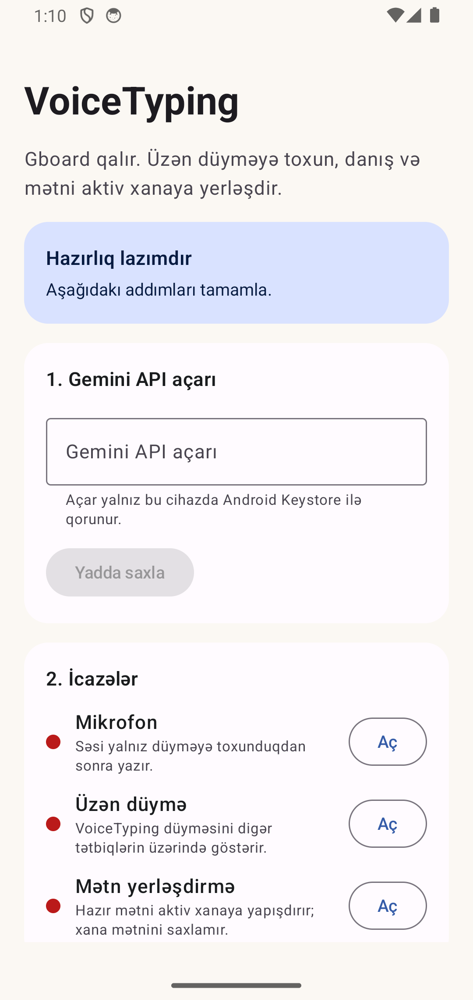
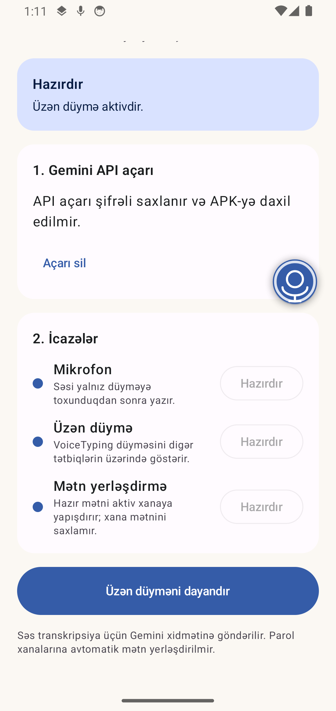
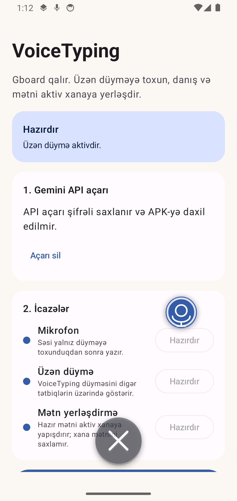

# VoiceTyping for Android

[](https://developer.android.com/about/versions/oreo)
[](https://kotlinlang.org/)
[](https://github.com/fadayat/voicetyping-android/actions/workflows/android.yml)
[](LICENSE)

VoiceTyping is a floating, system-wide voice typing tool for Android. Tap the movable orb, speak Azerbaijani, and receive the transcript in the currently focused text field without replacing your keyboard.

[Azərbaycan dilində quraşdırma təlimatı](docs/README.az.md)

## Screenshots

<p align="center">
  
  
  
</p>

## Highlights

- Keeps Gboard or any other keyboard as the active keyboard.
- Streams 16 kHz mono PCM audio to Gemini Live while recording.
- Queues audio captured during connection setup, so the beginning is not lost.
- Falls back to the Gemini batch transcription API when the live route fails.
- Pastes the final transcript through a narrowly scoped accessibility service.
- Never auto-pastes into password fields.
- Copies the transcript to the clipboard when direct paste is unavailable.
- Stores the user's API key with AES-GCM backed by Android Keystore.
- Does not save audio or transcript history.
- Lets the user drag the floating orb onto a bottom close target to stop the service.
- Uses explicit connection, finalization, network, and processing timeouts to prevent an indefinite “preparing text” state.

## How it works

```text
Tap orb
   |
   +-- start microphone capture
   +-- open Gemini Live connection in parallel
              |
              +-- stream queued and new PCM chunks
              |
          Tap orb again
              |
              +-- finalize live transcript
              +-- use batch fallback if needed
              |
        clipboard + safe accessibility paste
```

Audio remains in memory only for the active session. The in-memory copy supports validation and the batch fallback; it is discarded when the session ends.

## Install and use

1. Download the debug APK from the latest [GitHub Release](../../releases/latest).
2. Allow installation from the browser or file manager that opened the APK.
3. Open VoiceTyping and enter your own Gemini API key.
4. Grant microphone and “display over other apps” permissions.
5. Enable **VoiceTyping mətn yerləşdirmə xidməti** in Android Accessibility settings.
6. Tap **Üzən düyməni başlat**.
7. Focus any normal text field, tap the floating orb, speak, then tap the orb again.

To stop VoiceTyping, drag the orb onto the large **X** target at the bottom of the screen. You can also use the stop action in the app or notification.

> [!IMPORTANT]
> VoiceTyping sends recorded speech to Google's Gemini API for transcription. You supply the API key and are responsible for the associated account, quota, terms, and charges.

## Build from source

Requirements:

- Android Studio or Android SDK 34
- JDK 17 or 21 (JDK 25 is not supported by the current Android Gradle Plugin)
- Internet access for Gradle dependencies

```bash
git clone https://github.com/fadayat/voicetyping-android.git
cd voicetyping-android
./gradlew testDebugUnitTest lintDebug assembleDebug
```

The debug APK is generated at `app/build/outputs/apk/debug/app-debug.apk`.

No Gemini API key is required to compile or run the automated test suite. Do not place an API key in source code, Gradle files, `local.properties`, or a GitHub issue.

## Architecture

- **UI:** Jetpack Compose and Material 3
- **State:** `StateFlow` and lifecycle-aware collection
- **Concurrency:** Kotlin Coroutines and Flow
- **Dependency injection:** Hilt
- **Networking:** OkHttp WebSocket and HTTP
- **Audio:** Android `AudioRecord`, 16 kHz mono PCM
- **Credential storage:** Android Keystore with AES-GCM
- **Delivery:** Android clipboard plus a restricted accessibility paste action

The main transcription contract lives in the domain layer. The data layer owns Gemini Live, batch fallback, audio validation, and WAV encoding. The foreground service owns the floating control and session lifecycle.

## Verification

The project includes unit tests for message parsing, live and fallback routing, audio validation, WAV encoding, and dismiss-target geometry. Instrumented Compose tests cover the setup screen and permission state.

The v1.0.4 development build passed:

- 17 local unit tests
- Android lint
- Debug APK assembly
- 2 instrumented tests on an Android 14 emulator

A controlled end-to-end run with 5.28 seconds of synthetic Azerbaijani speech completed through the live route in 5.998 seconds total. The final transcript arrived 731 ms after recording stopped. Network and service conditions vary, so these figures are not a general latency guarantee.

## Privacy and security

Read [PRIVACY.md](PRIVACY.md) before use. Key points:

- Recording starts only after the user taps the orb.
- Audio and API requests go directly from the device to Google's Gemini service.
- VoiceTyping does not operate a separate backend.
- API keys are encrypted on-device and excluded from the repository and APK.
- The accessibility service does not subscribe to or store typed field content.
- Password fields are excluded from automatic paste.

For vulnerability reports, follow [SECURITY.md](SECURITY.md). Never include credentials or private recordings in a public issue.

## Current scope

- The interface and transcription configuration currently target Azerbaijani (`az-AZ`).
- The distributed APK is a debug build intended for sideloading and evaluation.
- Google Play distribution would require additional signing, store declarations, accessibility-policy review, and release hardening.
- The app depends on preview or evolving Gemini transcription endpoints. API availability and model names can change.

## Contributing

Bug reports and focused pull requests are welcome. Read [CONTRIBUTING.md](CONTRIBUTING.md) first. Planned improvements are tracked in [GitHub Issues](../../issues).

## License

Licensed under the [Apache License 2.0](LICENSE).

Google, Android, Gemini, and Gboard are trademarks of their respective owners. This project is independent and is not endorsed by Google.
